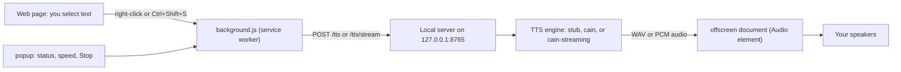

<div align="center">

# Stay Awhile And Listen

**Highlight text on a web page and hear it read aloud in a cloned voice, by a local server on your own PC.**


<!-- screenshot: popup -->

</div>

## What it does 🗣️

This is a Chrome extension plus a small Python server that run entirely on your machine. You select text on any page, trigger a read, and the server synthesizes speech in a voice cloned from a short reference clip you provide. Nothing is sent to a cloud service: the extension only ever talks to `http://127.0.0.1:8765`.

Features, all of them wired up in this repository:

- **Right-click menu:** select text, right-click, choose **Read with Cain**.
- **Keyboard shortcut:** `Ctrl+Shift+S` reads the current selection. While audio is playing the same shortcut stops it, so it works as a toggle.
- **Popup controls:** a status light for the local server, a speed slider (0.8 to 1.4, remembered between sessions), and a **Stop** button.
- **Playback that survives browsing:** audio is played by a hidden offscreen page, so it keeps going while you switch tabs.
- **Long text handled in pieces:** selections are split into sentences, capped at 5,000 characters, and the next chunk is requested while the current one plays.
- **Two engines:** `stub` returns a short test tone with no model at all, and `cain` runs the real voice-clone model on your GPU.
- **Streaming mode:** the optional `cain-streaming` engine plays audio as the model produces it, so speech starts almost immediately.

## How it works



The service worker does the talking to the server, because a web page is not allowed to call `http://127.0.0.1`, and the extension's `host_permissions` make the service worker exempt. Playback happens in an offscreen document, because a Manifest V3 service worker cannot play audio and is shut down when idle.

<details>
<summary>Prefer plain text? Here is the same picture as ASCII</summary>

```
 Web page: select text
        |
        | right-click "Read with Cain"  or  Ctrl+Shift+S
        v
 background.js (service worker) --- chunk the text, then POST /tts/stream or /tts
        |                                          |
        |                                          v
        |                              Local server on 127.0.0.1:8765
        |                              engine: stub | cain | cain-streaming
        |                                          |
        |                                          v
        |                              audio (WAV or raw PCM chunks)
        v                                          |
 offscreen document (Audio element) <---------------+
        |
        v
 Your speakers

 popup (status, speed, Stop) ---> background.js
```

</details>

## Requirements 🧰

| Item | What you need | Source in the code |
|------|----------------|--------------------|
| Operating system | Windows 10 or 11, with PowerShell. All commands here assume PowerShell. | `TASKS.md`, server notes |
| Python | 3.12. The virtual environment here was created with `py -3.12 -m venv .venv` and reports 3.12.10. | `server\.venv\pyvenv.cfg` |
| Chrome | Version 116 or newer. | `extension/manifest.json` (`minimum_chrome_version: "116"`) |
| GPU | An NVIDIA GPU with a CUDA driver, for the real voice engine: it loads the model on `cuda:0`. The stub engine needs no GPU but only plays a tone. The reference machine is an RTX 3090. | `server/engines/cain.py` |
| Reference audio | Your own short clip plus its exact transcript, placed in `server\voices\`. These files are gitignored and are **not** shipped in the repository. | `PRD.md`, `.gitignore` |
| Network, once | The voice model weights are downloaded from Hugging Face the first time the engine runs, then cached outside this project. No weights live in the repo. | `server/engines/cain.py` |

> **Note:** speed changes are applied by the audio player with pitch preserved, so the server always synthesizes at normal speed. Speech starts fastest at speed 1.00, where the extension can use streaming; at other speeds it waits for one full synthesis before playing.

The exact package versions that make up the production and streaming environments are recorded in [`docs\environments.md`](docs/environments.md).

## Install ⚙️

### Part 1: start the server

1. Get the code and open PowerShell in the folder that contains this `README.md`.

   ```powershell
   Set-Location C:\GitRepo\Stay_Awhile_And_Listen
   ```

2. Create the Python 3.12 virtual environment inside `server\`.

   ```powershell
   Set-Location server
   py -3.12 -m venv .venv
   .\.venv\Scripts\python.exe --version
   ```

   The version must print 3.12.x. If `py -3.12` is not found, install Python 3.12 first.

3. Install PyTorch (the CUDA build) **before** the rest, so pip does not replace it with a CPU build.

   ```powershell
   .\.venv\Scripts\python.exe -m pip install torch torchvision --index-url https://download.pytorch.org/whl/cu132
   ```

4. Install the remaining server packages.

   ```powershell
   .\.venv\Scripts\python.exe -m pip install -r requirements.txt
   ```

5. Add your voice files to `server\voices\`: a clean `cain.wav` (mono, roughly 10 to 30 seconds, no music) and `cain.txt` containing the exact words spoken in that clip.

   ```powershell
   Get-ChildItem .\voices
   ```

6. Start the server with the real voice engine.

   ```powershell
   $env:CAIN_ENGINE = "cain"
   .\run.ps1
   ```

7. In a second PowerShell window, check that it is alive.

   ```powershell
   curl.exe -s http://127.0.0.1:8765/health
   ```

   You should see `{"ok":true,"engine":"cain","voice":"cain"}`. The server loads the model and speaks one warm-up sentence at startup, so wait for its startup messages to settle before your first read.

> **Tip:** there is a one-click launcher, `start-cain-server.cmd`, in the repo root. Double-click it (or run it from PowerShell) and it will pick the right Python, set the engine, and refuse to start a second server if port 8765 is already busy. `start-cain-server.cmd /check` only reports the paths and the port state. Leave that window open while you use the extension; `Ctrl+C` stops the server.

> **Note:** if PowerShell refuses to run the script with an execution policy error, run this once and try again:
>
> ```powershell
> Set-ExecutionPolicy -Scope CurrentUser RemoteSigned
> ```

<details>
<summary>Optional: the faster streaming engine</summary>

The `cain-streaming` engine uses a community fork of Qwen3-TTS that can emit audio while it is still generating, which is what cuts the wait to about a second on the reference machine. The fork pins different versions of PyTorch and of the `qwen-tts` package than the `cain` engine, so it cannot live in `server\.venv` without breaking the working engine. It belongs in a separate environment.

`start-cain-server.cmd` prefers a separate environment at `C:\TTS-Streaming-Test\.venv` when that folder exists, starts it with `CAIN_ENGINE=cain-streaming` and `CAIN_STREAMING_OPTIMIZE=1`, and otherwise falls back to `server\.venv` with `CAIN_ENGINE=cain`. To stop using streaming, remove the environment variable and restart, or simply start the server from `server\` with the `cain` engine as shown above.

</details>

### Part 2: load the extension

1. Open `chrome://extensions` in Chrome.
2. Turn on **Developer mode** (top right corner).
3. Click **Load unpacked**.
4. Select the `extension` folder inside this repository, for example `C:\GitRepo\Stay_Awhile_And_Listen\extension`.
5. The card appears with no **Errors** button. Click the puzzle-piece icon in the toolbar and pin the extension if you want its icon always visible.

If you later change any file in `extension\`, click the reload arrow on the extension card so Chrome picks up the new code.

## How to use 🎧

<!-- screenshot: popup -->

1. Make sure the server is running and the popup dot is green.
2. Open any normal web page (an `http` or `https` page, not a `chrome://` page).
3. Select the text you want to hear.
4. Start a read in either way:
   - Right-click the selection and choose **Read with Cain**, or
   - Press `Ctrl+Shift+S`.
5. Press `Ctrl+Shift+S` again, or click **Stop** in the popup, to stop playback.
6. Open the popup to check the server status, drag the speed slider (0.8 to 1.4), or stop playback. The speed you pick is saved and reused next time.

Notes on behaviour, all of it from the code:

- If you start a read while something is playing, the old read is cancelled first, so audio never overlaps.
- The keyboard shortcut is a toggle: while a read is in progress it stops that read. To read a different selection mid-playback, use **Read with Cain** from the context menu, or press the shortcut twice.
- Selections longer than 5,000 characters are trimmed, and a toast says **Reading first 5,000 characters**.
- An empty selection shows a toast, **Select some text first**, and no audio.
- On pages where the extension cannot read the selection directly (for example a `chrome://` page), the context-menu item still works because Chrome supplies the selected text itself.
- Failures are visible: you get a toast such as **Cain server offline**.

## Troubleshooting 🩺

| Problem | Likely cause | Fix |
|---------|--------------|-----|
| Popup dot is red and reads "Server offline", and reads show a "Cain server offline" toast | The server is not running, or it is on another port | Start it (`start-cain-server.cmd`, or `$env:CAIN_ENGINE="cain"; .\run.ps1` from `server\`), then open `http://127.0.0.1:8765/health` |
| The server answers, but you only hear a short buzz or tone | The engine is `stub`, which is the default when `CAIN_ENGINE` is not set | Start the server with `$env:CAIN_ENGINE="cain"`, or use the launcher |
| The server exits at startup with "missing reference file" | `server\voices\cain.wav` or `cain.txt` is missing. They are gitignored and never shipped | Add your own clip and its exact transcript to `server\voices\` |
| The first read stalls for a long time, or fails with a download error | The model weights are being fetched from Hugging Face for the first time, or there is no internet | Let the first download finish. Once cached, you can run fully offline with `$env:HF_HUB_OFFLINE="1"` before starting the server |
| The launcher says port 8765 is already in use | Another server (an earlier run, or a different app) owns the port | Open `http://127.0.0.1:8765/health`; stop the old server, or close the app using the port |
| `Ctrl+Shift+S` does nothing | Another extension or app already uses that shortcut | Open `chrome://extensions/shortcuts` and rebind **Read selected text aloud** |
| `.\run.ps1` will not start at all | PowerShell execution policy | Run `Set-ExecutionPolicy -Scope CurrentUser RemoteSigned` once |
| Speech starts late, or playback stutters | The GPU is busy (a local LLM, a game, or a video call), or the speed is not 1.00, which disables streaming | Free the GPU and keep the speed at 1.00 for the fastest start |
| Nothing happens on a `chrome://` page or a browser settings page | Content scripts cannot run on those pages | Use a normal web page; the right-click item still works where the selection text is available |
| Text inside a frame on the page is not read | The selection was made inside an iframe | Select it and use the right-click **Read with Cain** item |
| Audio plays but you hear the wrong voice | The engine loaded, but the reference clip changed | Replace `cain.wav` and `cain.txt` as a pair, with the transcript matching the clip exactly, and restart the server |

## Project structure 📁

```
Stay_Awhile_And_Listen\
|-- extension\                    Chrome extension (Manifest V3, vanilla JS, no bundler)
|   |-- manifest.json             Permissions, shortcut, context menu wiring
|   |-- background.js             Service worker: triggers, chunking, server calls
|   |-- chunker.js                Pure text splitter (unit tested)
|   |-- content.js                Selection access and on-page toasts
|   |-- offscreen.html / .js      Hidden audio player with a queue
|   |-- popup.html / .js / .css   Status, speed slider, Stop
|   |-- fonts\Exocet-Light.ttf    Font used by the popup
|   |-- icons\                    Toolbar and store icons (16, 48, 128)
|   `-- tests\                    chunker, offscreen and background tests
|-- server\                       Local TTS server (FastAPI)
|   |-- app.py                    GET /health, POST /tts, POST /tts/stream
|   |-- engines\                  base, stub, cain, and cain_streaming engines
|   |-- tests\                    test_app.py, test_engines.py
|   |-- voices\                   Your cain.wav and cain.txt (gitignored)
|   |-- requirements.txt          Server packages
|   |-- run.ps1                   Starts uvicorn on 127.0.0.1:8765
|   `-- NOTES.md                  Install notes and recorded probe results
|-- start-cain-server.cmd         One-click server launcher
|-- scratch\                      Temporary test pages and audio (gitignored)
|-- voice-source\                 Your raw audio material (gitignored)
|-- PRD.md  TASKS.md              The product spec and the build plan
|-- TASKS_QWEN_STREAMING.md       The streaming experiment plan and its results
|-- NOTES.md                      Measured results, edge cases, user checklists
|-- docs\                        Project records
|   |-- environments.md          Exact package versions for both Python environments
|   |-- FLATTEN_REPO_PLAN.md     The repository flattening plan (historical)
|   `-- diablo-icon-02.png       Unused image, not loaded by the extension
`-- README.md                     This file
```

<details>
<summary>Running the tests (optional)</summary>

Server tests, from the `server` folder:

```powershell
.\.venv\Scripts\python.exe -m pytest -q
```

Extension tests, from the repo root (the recorded runs used Node v20.19.0):

```powershell
node --test extension/tests/chunker.test.js extension/tests/offscreen.test.js extension/tests/background.test.js
```

</details>

## Credits and notes 📜

- **The voice is yours.** The project ships no audio. You provide `server\voices\cain.wav` and its transcript `cain.txt`. The intended use is personal and local: do not redistribute the clip, and do not publish the extension with the voice bundled.
- **Speech model:** [Qwen3-TTS](https://github.com/QwenLM/Qwen3-TTS), specifically the `Qwen/Qwen3-TTS-12Hz-1.7B-Base` voice-clone model, loaded in bfloat16 on CUDA.
- **Streaming fork:** the optional `cain-streaming` engine uses [dffdeeq/Qwen3-TTS-streaming](https://github.com/dffdeeq/Qwen3-TTS-streaming), which the plan itself flags as a community project whose advertised speedup is not independently verified.
- **Supporting libraries:** PyTorch, FastAPI, uvicorn, numpy, and librosa (used by the non-streaming engine when a speed other than 1.0 is requested).
- **Font:** `extension/fonts/Exocet-Light.ttf` is a third-party typeface bundled for the popup. Check its licence before you redistribute this project.
- **Icons:** the toolbar icons are generated placeholder PNGs. `docs\diablo-icon-02.png` is an unused image kept for reference; the extension does not load it.
- **Blizzard assets:** Deckard Cain, "Stay awhile and listen", and Diablo artwork belong to Blizzard Entertainment. This is a personal, non-commercial tool and it bundles none of their audio.
- **Licence:** this repository has no `LICENSE` file, so no licence is granted by default.
- **Recorded performance (developer's RTX 3090, measured by the project author, not by a test):** the streaming engine starts speech in about a second or less after warm-up, with a first chunk around 0.21 to 0.24 seconds and a real-time factor near 0.65. The non-streaming `cain` baseline was roughly 22 to 24 seconds for a long sentence. Expect slower numbers on other hardware, and expect the very first request after a restart to take longer while the model loads.
